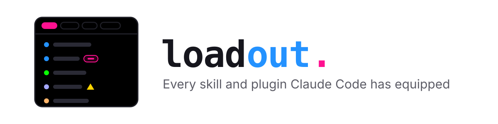
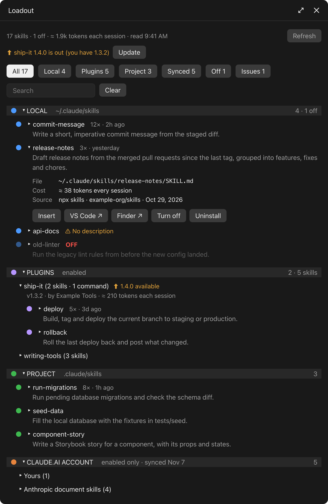

<h1 align="center">
	<picture>
		<source media="(prefers-color-scheme: dark)" srcset="docs/brand/banner-dark.svg">
		
	</picture>
</h1>

<p align="center">
	<strong>Every skill and plugin Claude Code has equipped, in one pane.</strong>
</p>

<p align="center">
	<a href="https://github.com/webdevnerdstuff/claude-loadout/releases/latest"></a>
	<a href="https://github.com/webdevnerdstuff/claude-loadout/actions/workflows/ci.yml"></a>
	
	<a href="LICENSE"></a>
</p>

<p align="center">
	<a href="#install">Install</a> ·
	<a href="#use">Use</a> ·
	<a href="#features">Features</a> ·
	<a href="#where-it-looks">Where it looks</a> ·
	<a href="#develop">Develop</a>
</p>

<p align="center">
	
</p>

Your own skills, the project's, every enabled plugin and the skills on your claude.ai account, side by side. For each one you see what it does, where it lives and whether it's turned off, and one click puts its command in the prompt box.

> [!TIP]
> **Browsing your loadout uses zero tokens.** Asking Claude "what skills do I have?" spends tokens on every answer. loadout reads your skill folders locally and never calls the model.

The desktop app's **Customize → Skills** page only lists your claude.ai account skills. Skills in `~/.claude/skills`, a project's `.claude/skills` and plugins don't show up there. loadout lists them all.

## Install

In a Claude Code terminal session:

```bash
/plugin install loadout --marketplace webdevnerdstuff/claude-loadout
```

Answer `y` to add the marketplace, then pick **user** scope so it loads in every session, including the desktop app's.

**Requirements:** Claude Code 2.1.317 or newer (the desktop app's Code tab, or the CLI). The claude.ai account section, **VS Code ↗**, **Finder ↗** and the Uninstall / Delete shortcut / Move to Trash buttons need macOS; everything else works anywhere.

<details>
<summary><strong>Update or remove</strong></summary>

To update, refresh the marketplace, then update the plugin and restart Claude Code:

```bash
claude plugin marketplace update claude-loadout
```

```bash
claude plugin update loadout@claude-loadout
```

To remove it:

```bash
claude plugin uninstall loadout@claude-loadout
```

</details>

## Use

1. Run `/loadout` in any session. The **Loadout** pane opens.

   **In a terminal**, the pane docks beside the chat only in Claude Code's fullscreen renderer: run `/tui fullscreen` once to turn it on for every session. Without it, the pane opens above the prompt. If the keys go back to the prompt, press <kbd>Ctrl</kbd>+<kbd>X</kbd> <kbd>Tab</kbd> (twice if a mod puts a bar above the prompt) or run `/loadout` again.

2. Type to search: the list narrows to skills and commands whose name, description or plugin matches, as you type; **Clear** empties it. Or pick a chip to narrow the list.
3. Click a skill to read its full description and see where its file lives.
4. In an expanded skill, click **Insert** to start a prompt with it, or **VS Code ↗** to edit it.

**Refresh** reads the folders again. The pane also rescans each time you run `/loadout`. Plugins register their commands as a session starts, so a command added after the first scan shows after a refresh.

## Features

### 🗂️ See everything

| Section | What's listed |
| --- | --- |
| **Local** | `~/.claude/skills` |
| **Project** | `.claude/skills` |
| **Plugins** | Each enabled plugin, including ones loaded from `CLAUDE_CODE_PLUGIN_DIRS`, with its skills and its slash commands, even ones a mod registers in code |
| **claude.ai account** | Only the account skills that are turned on |

- **Search as you type**: by name, description or plugin, across every section, opening folded plugin groups that hold a match
- **Filter chips**: All, Local, Plugins, Project, Synced, Off, Issues
- **Collapsible sections**: click a heading (Local, Plugins, Project, …) to close or open it
- **What each skill does**: a one-line summary from its `SKILL.md`, expanded to the full description with a click
- **Details**: an expanded skill lists its **File**, its **Cost** and its **Source** (e.g. `npx skills · typesafe-ai/skills · Oct 29, 2026` or `superpowers plugin · claude-plugins-official marketplace`)
- **Off at a glance**: skills set to `"off"` in `skillOverrides` are dimmed and tagged **OFF**
- **Token cost**: roughly what each skill's description costs, since every session carries it, and the total across the skills that are on
- **Usage counts**: how often each skill ran and when it last did, kept across sessions

### ⚠️ Spot problems

Problems are flagged with ⚠ and counted under **Issues**. Hints are marked ⓘ, dimmed and not counted.

<details>
<summary><strong>What gets flagged</strong></summary>

**Problems (⚠)**

- the same skill name in more than one place, including a skill a disabled plugin also ships
- no frontmatter, or no description
- a broken symlink, or a folder with no `SKILL.md`
- a file `SKILL.md` links to that isn't there
- a description over 1,024 characters
- a name that isn't lowercase letters, digits and hyphens, or that differs from its folder
- `skill.md` in lowercase, which works on a Mac and is missed on Linux
- a name a built-in command already has, like `/init`
- a `skillOverrides` entry for a skill that no longer exists

**Hints (ⓘ)**

- a very short description
- a `SKILL.md` over 500 lines
- no instructions under the frontmatter

</details>

### 🔧 Fix them in a click

Flagged skills show their fix in place of **Insert**:

| Problem | Fix |
| --- | --- |
| Broken symlink | **Remove link** (after you confirm) and **Finder ↗** |
| No `SKILL.md` | **Create SKILL.md**: a starter file, opened in VS Code |
| No frontmatter | **Add frontmatter**: a starter header above the existing text |
| No description | **VS Code ↗** |
| Lowercase `skill.md` | **Rename to SKILL.md** |
| Duplicate | **Ask Claude**: puts a question about the two copies in the prompt box |
| Also in a disabled plugin | **Uninstall &lt;plugin&gt; plugin** (after you confirm), with Claude Code's own `claude plugin uninstall`. When it's that marketplace's last plugin, the marketplace goes too |
| Stale `skillOverrides` entry | **Remove from settings** |
| Anything else | **VS Code ↗** |

### 🎛️ Manage skills

- **Insert**: puts the skill's command at the start of the prompt box, keeping what you typed after it. It never sends. Skills that are off have no Insert.
- **Turn off / Turn on**: sets the skill to `"off"` in `skillOverrides` of `~/.claude/settings.json`, the way `/skills` does, or removes that entry. The files stay; it takes effect straight away.
- **Uninstall / Delete shortcut / Move to Trash** (macOS, Local skills): takes the skill off your machine the way it got there. The files go to the Trash, and its `"off"` entry is removed too.
  - A skill `npx skills` installed shows **Uninstall**: its shared folder in `~/.agents/skills` moves to the Trash, Claude Code's shortcut is deleted and its entry leaves `~/.agents/.skill-lock.json`. No Node or `npx` is needed; other tools' shortcuts to it, if any, stop working.
  - A shortcut (symlink) shows **Delete shortcut**, which deletes only the shortcut.
  - A real folder shows **Trash**.
- **VS Code ↗** (Local and Project skills): opens the skill's `SKILL.md` in VS Code, or in your default text editor when VS Code isn't installed
- **Finder ↗** (Local and Project skills): shows the skill's folder in Finder

Anything that removes something asks first, in Claude Code's own dialog. Where that dialog can't open, for example while Claude is mid-turn, the row shows an inline confirm with **Cancel** instead. What just happened shows at the top of the pane ("✓ Turned typesafe-ai on") for a few seconds. If Claude Code can't be run for Uninstall plugin, the command is copied for you to paste into a terminal.

### ⬆️ Plugin updates

Once a day (and on **Refresh**) loadout checks each installed plugin's marketplace on GitHub for a newer version. An update shows at the top of the pane ("⬆ skins 0.5.16 is out (you have 0.5.12)") and on the plugin, with an **Update** button that runs Claude Code's own `claude plugin marketplace update` and `claude plugin update`. Restart Claude to use it. Only plain `x.y.z` versions count.

## Where it looks

| Section | Read from |
| --- | --- |
| Local | `~/.claude/skills/*/SKILL.md`, symlinks followed, except `synced/` |
| Project | `<project>/.claude/skills/*/SKILL.md` |
| Plugins | `~/.claude/plugins/installed_plugins.json` for the plugins `enabledPlugins` turns on, plus each folder in `CLAUDE_CODE_PLUGIN_DIRS`. Their `skills/` folders and any `skills` paths in their `plugin.json`, and the commands Claude Code lists for each plugin |
| claude.ai account | The desktop app's own copy of your account skills, `~/Library/Application Support/Claude/local-agent-mode-sessions/skills-plugin/<org>/<account>/manifest.json`. Only skills with `enabled: true` are listed |
| OFF | `skillOverrides` in your merged settings |

> [!IMPORTANT]
> **loadout never writes inside a repo.** **Turn on**, **Turn off**, the remove buttons and **Remove from settings** only ever edit `skillOverrides` in your own `~/.claude/settings.json`. If a skill is turned off in a project's `.claude/settings.json` or `.claude/settings.local.json`, the pane says so and leaves it. Fix buttons that write files (Create SKILL.md, Add frontmatter, Rename, Remove link) are for Local skills only.
>
> Only those entries change: the rest of the file, its key order and its indentation stay as they were, and the file is read back to check it's still valid JSON. loadout reads the file on your machine only: its contents never go to Claude.

> [!NOTE]
> `~/.claude/skills/synced/` is an older copy of your account skills that the app stops updating. loadout reads the app's current copy instead, so a skill you removed from your account doesn't linger. That folder is the app's own and undocumented. If an update moves it, the claude.ai account section shows none until loadout catches up.

Usage counts are kept in the plugin's own store. They start at zero when you install it: Claude Code keeps no history of past skill runs.

## Develop

```bash
pnpm check  # validates the manifests and runs the engine tests
```

Load it from the folder while you work on it: `claude --plugin-dir .`. See [AGENTS.md](AGENTS.md) for how it is put together.

## License

MIT © WebDevNerdStuff
